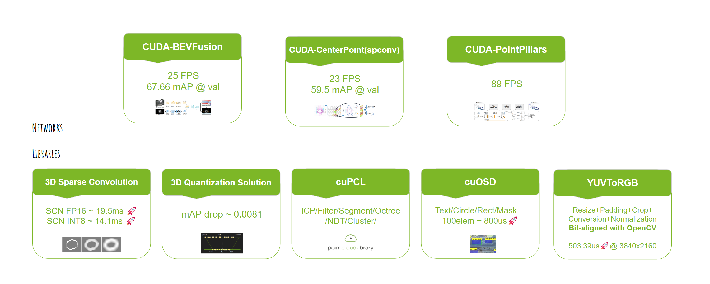
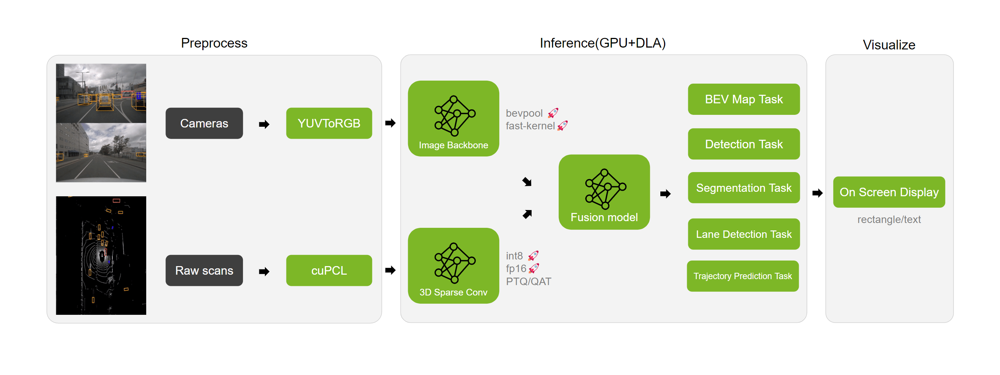

# BEVFusion：从内置源码构建的稀疏卷积后端

`master` 分支默认使用 `BEVFUSION_SPARSE_BACKEND=open`。spconv 2.3.8、cumm 0.7.11 和图执行兼容层源码均已纳入项目，可直接审查、修改、编译生成自己的 `libspconv.so` 与 `libscn.so`。当前源码后端支持 FP16，不支持 INT8；完整相机、融合和检测头仍使用 TensorRT。

自 2026-10-20 起，原 `lg/open-spconv-3070` 实现由 `master` 维护；原 Jetson AGX 版本完整保留在 [`orin-AgX`](https://github.com/luogantt/Robot_infer/tree/orin-AgX) 分支。

这是一个面向部署的 **BEVFusion C++/CUDA 推理项目**：六路相机和 LiDAR 点云分别提取 BEV 特征，完成融合后输出三维检测框。默认路径已经不再加载 NVIDIA 项目附带的预编译闭源 `libspconv.so`；新的底层库由项目内 spconv/cumm 源码生成，并与源码可见的 `libscn.so` 执行层配套使用。它仍然需要 CUDA、cuBLAS 和 TensorRT。


## 先看这里

| 内容 | 入口 |
| --- | --- |
| 项目介绍文章 | [BEVFusion 推理：用源码可构建的稀疏卷积后端替代闭源动态库](docs/BEVFUSION_OPEN_SPARSE_BACKEND.md) |
| 从零编译与推理 | [完整构建与运行指南](libraries/New3DSparseConvolution/README.md) |
| 实测环境与原始指标 | [GPU 分批验证记录](libraries/New3DSparseConvolution/VALIDATION.md) |
| 两个动态库的源码来源 | [源码与许可证说明](libraries/New3DSparseConvolution/UPSTREAM.md) |

**从克隆到完整推理，请按 [完整构建与运行指南](libraries/New3DSparseConvolution/README.md) 依次执行。** 指南从统一的 `PROJECT_ROOT` 开始，给出了所有环境变量、可复制命令、输出路径和输入格式，不需要跳回旧 NVIDIA 部署步骤。

2026-10-17 已在 **RTX 3090 / CUDA 12.8 / TensorRT 10.13.3.9** 上完成本轮全新源码重建：使用 `f3c9793` 内置源码加 `build_deps.sh` 的部分 venv 恢复修复，在新的依赖/构建目录生成动态库，并重新构建四个 TensorRT 引擎。XYZ/ZYX 数值对照、8/8 非方形回归、官方样例与 mini_val 81/81 帧均通过运行检查。

| 本轮完整 FP16 推理 | 平均延迟 | P95 | 单帧串行 FPS |
| --- | ---: | ---: | ---: |
| 官方样例重复 100 次 | 19.226500 ms | 19.548640 ms | 52.011548 |
| mini_val 81 帧 | 22.242601 ms | 23.898073 ms | 44.958771 |

计时包含正常 forward，排除读取、标定更新、预检、预热和可视化；mini 每帧先预检再测量。数字来自 3090，不是 3070 Ti 实测，也不代表精度评估或相对首次测试的性能提升。完整环境、指标和两次测试的区别见 [分批验证记录](libraries/New3DSparseConvolution/VALIDATION.md#本轮从内置源码全新重建)。


```bash
git clone --branch master --single-branch \
  https://github.com/luogantt/Robot_infer.git
cd Robot_infer/bevfusion_agx
export PROJECT_ROOT="$PWD"
```

| 步骤 | 做什么 | 产物 / 说明 |
| --- | --- | --- |
| [1–2：环境](libraries/New3DSparseConvolution/README.md#2-系统依赖与-cuda-架构) | 安装 GCC、CMake、Python venv、Protobuf 和 CUDA，设置 GPU 架构 | 示例为 Ubuntu 22.04、CUDA 12.8、SM 86 |
| [3：底层内核](libraries/New3DSparseConvolution/README.md#3-从内置源码生成底层-libspconvso) | `build_deps.sh` 复制项目内源码并生成、编译 CUDA 内核 | `$NEWSCN_DEPS_ROOT/spconv/example/libspconv/build/spconv/src/libspconv.so` |
| [4：稀疏执行层](libraries/New3DSparseConvolution/README.md#4-编译-libscnso-和独立稀疏卷积检查程序) | CMake 编译兼容层和独立检查程序 | `$SCN_BUILD/libscn.so`、`sparse_backend_check`，不需要 TensorRT |
| [5–6：完整程序](libraries/New3DSparseConvolution/README.md#5-安装-tensorrt-10-的构建与-python-环境) | 配置 TensorRT 10.13.3.9 头文件/库并编译 | `$BEV_BUILD/bevfusion`、`libbevfusion_core.so`、`open-sparse/libscn.so` |
| [7：模型与引擎](libraries/New3DSparseConvolution/README.md#7-获取模型与样例构建四个-tensorrt-引擎) | 获取官方 ResNet50 ONNX 与样例，运行 `build_fp16_engines.py` | 四个 FP16 `.plan` 及构建 manifest，不需要 `trtexec` |
| [8：完整推理](libraries/New3DSparseConvolution/README.md#8-单帧完整推理与计时) | 单帧运行、预热、重复计时和阶段分析 | 可视化 JPEG 与 benchmark JSON |
| [9：多帧测试](libraries/New3DSparseConvolution/README.md#9-nuscenes-mini-多帧输入与测试) | 将 nuScenes mini 转换为六相机、点云和标定输入 | `data-list.txt`，复用同一 core 逐帧推理 |

本分支生成的 `libspconv.so` 与旧 NVIDIA 库同名，但 API/ABI 不兼容，必须搭配本分支完整程序，不能仅替换旧程序中的一个 `.so`。构建不下载 spconv/cumm 源码或 NVIDIA 预编译稀疏库；Python 通用代码生成依赖仍从 pip 安装，CUDA、cuBLAS、TensorRT 仍需另行安装，所以并非全离线或非 NVIDIA 平台方案。

源码在 [third_party](libraries/New3DSparseConvolution/third_party)，版本及许可证记录见 [source-manifest.json](libraries/New3DSparseConvolution/third_party/source-manifest.json) 和 [UPSTREAM.md](libraries/New3DSparseConvolution/UPSTREAM.md)。修改内置源码后应选择新的 `NEWSCN_DEPS_ROOT` 和构建目录；脚本及 CMake 会拒绝缺少来源状态或与当前源码不一致的旧副本。

RTX 3070 Ti / RTX 3090 可使用 SM 86 构建目标；本分支不能直接运行在瑞芯微 NPU 或华为昇腾上。原项目说明、旧 Jetson 日志和历史性能数字保留在下面，它们不代表本分支源码后端的当前实测结果。

<details>
<summary>原 Jetson / CUDA 11.4 部署记录（旧 NVIDIA 后端）</summary>

以下关于 NVIDIA 预编译 `libspconv.so` 的描述仅适用于显式选择 `BEVFUSION_SPARSE_BACKEND=nvidia` 的旧后端；不要将其作为上方源码构建流程的必要步骤。

 环境是 11.4 ，我是用sdkmanager 刷的系统，各种组件 都刷上了，而且只能通用 ubuntu 本机刷系统 ，虚拟机不行 ，在刷的过程中 需要频繁 连接 。
```
nvcc: NVIDIA (R) Cuda compiler driver
Copyright (c) 2005-2022 NVIDIA Corporation
Built on Sun_Oct_23_22:16:07_PDT_2022
Cuda compilation tools, release 11.4, V11.4.315
Build cuda_11.4.r11.4/compiler.31964100_0
```

######   cmake 也要更改过 ，在头部加几行代码

 [我的cmake](https://github.com/luogantt/Lidar_AI_Solution/blob/master/CUDA-BEVFusion/CMakeLists.txt)
 

```

# 强制 Protobuf 使用动态库（添加在文件最顶部）
set(Protobuf_USE_STATIC_LIBS OFF)
set(Protobuf_USE_SHARED_LIBS ON)

# 显式指定 Protobuf 动态库路径（兜底）
find_library(PROTOBUF_SHARED_LIB protobuf PATHS /usr/local/lib NO_DEFAULT_PATH)
if(NOT PROTOBUF_SHARED_LIB)
    message(FATAL_ERROR "Protobuf dynamic library not found!")
endif()
```
 
<font color =darkred >还有一点要必须强调的是 Lidar_AI_Solution下面项目 编译的时候都依赖 /libraries/3DSparseConvolution/libspconv 下面的 动态库，比如我的 cuda=11.4 就需要 libspconv/lib/aarch64_cuda11.4/libspconv.so 这个动态库
 <font color =darkblue >/libspconv.so 这个动态库不开源！
  <font color =darkblue >/libspconv.so 这个动态库不开源！
    <font color =darkblue >/libspconv.so 这个动态库不开源！
      <font color =darkblue >重要事情说三遍！

##### 第二个问题就是 protobuf 需要安装好 基本上就是 这个两个问题要特别注意

###### 其他按照教程就可以了


```
=============================================
==================BEVFusion===================
[⏰ [NoSt] CopyLidar]: 	0.52656 ms
[⏰ [NoSt] ImageNrom]: 	7.13533 ms
[⏰ Lidar Backbone]: 	18.64733 ms
[⏰ Camera Depth]: 	0.16378 ms
[⏰ Camera Backbone]: 	13.59942 ms
[⏰ Camera Bevpool]: 	2.53222 ms
[⏰ VTransform]: 	2.66922 ms
[⏰ Transfusion]: 	8.26883 ms
[⏰ Head BoundingBox]: 	16.14006 ms
Total: 62.021 ms
=============================================
Save to build/cuda-bevfusion.jpg
[Warning]: If you got an inaccurate boundingbox result please turn on the layernormplugin plan. (main.cpp:207)

```


  
  

  


</font></font></font></font></font>
</details>

## 原 NVIDIA 项目概览

以下保留上游项目介绍。其 clone 地址会取得原 NVIDIA 仓库；要使用本分支的内置源码后端，请使用本页顶部的地址和构建指南。

<h1 style="text-align: center">Lidar AI Solution</h1>
This is a highly optimized solution for self-driving 3D-lidar repository.
It does a great job of speeding up sparse convolution/CenterPoint/BEVFusion/OSD/Conversion.



## Pipeline overview


## GetStart
```
$ git clone --recursive https://github.com/NVIDIA-AI-IOT/Lidar_AI_Solution
$ cd Lidar_AI_Solution
```
- For each specific task please refer to the readme in the sub-folder.

## 3D Sparse Convolution
A tiny inference engine for [3d sparse convolutional networks](https://github.com/tianweiy/CenterPoint/blob/master/det3d/models/backbones/scn.py) using int8/fp16.
- **Tiny Engine:** Tiny Lidar-Backbone inference engine independent of TensorRT.
- **Flexible:** Build execution graph from ONNX.
- **Easy To Use:** Simple interface and onnx export solution.
- **High Fidelity:** Low accuracy drop on nuScenes validation.
- **Low Memory:** 422MB@SCN FP16, 426MB@SCN INT8.
- **Compact:** Based on the CUDA kernels and independent of cutlass.

## CUDA BEVFusion
CUDA & TensorRT solution for [BEVFusion](https://arxiv.org/abs/2205.13542) inference, including:
- **Camera Encoder**: ResNet50 and finetuned BEV pooling with TensorRT and onnx export solution.
- **Lidar Encoder**: Tiny Lidar-Backbone inference independent of TensorRT and onnx export solution.
- **Feature Fusion**: Camera & Lidar feature fuser with TensorRT and onnx export solution.
- **Pre/Postprocess**: Interval precomputing, lidar voxelization, feature decoder with CUDA kernels.
- **Easy To Use**: Preparation, inference, evaluation all in one to reproduce torch Impl accuracy.
- **PTQ**: Quantization solutions for [mmdet3d/spconv](https://github.com/mit-han-lab/bevfusion/tree/main/mmdet3d/ops/spconv), Easy to understand.


## cuOSD(CUDA On-Screen Display Library)
Draw all elements using a single CUDA kernel.
- **Line:** Plotting lines by interpolation(Nearest or Linear).
- **RotateBox:** Supports drawn with different border colors and fill colors.
- **Circle:** Supports drawn with different border colors and fill colors.
- **Rectangle:** Supports drawn with different border colors and fill colors.
- **Text:** Supports [stb_truetype](https://github.com/nothings/stb/blob/master/stb_truetype.h) and [pango-cairo](https://pango.gnome.org/) backends, allowing fonts to be read via TTF or using font-family.
- **Arrow:** Combination of arrows by 3 lines.
- **Point:** Plotting points by interpolation(Nearest or Linear).
- **Clock:** Time plotting based on text support

## cuPCL(CUDA Point Cloud Library)
Provide several GPU accelerated Point Cloud operations with high accuracy and high performance at the same time: cuICP, cuFilter, cuSegmentation, cuOctree, cuCluster, cuNDT, Voxelization(incoming).
- **cuICP:** CUDA accelerated iterative corresponding point vertex cloud(point-to-point) registration implementation.
- **cuFilter:** Support CUDA accelerated features: PassThrough and VoxelGrid.
- **cuSegmentation:** Support CUDA accelerated features: RandomSampleConsensus with a plane model.
- **cuOctree:** Support CUDA accelerated features: Approximate Nearest Search and Radius Search.
- **cuCluster:** Support CUDA accelerated features: Cluster based on the distance among points.
- **cuNDT:** CUDA accelerated 3D Normal Distribution Transform registration implementation for point cloud data.

## YUVToRGB(CUDA Conversion)
YUV to RGB conversion. Combine Resize/Padding/Conversion/Normalization into a single kernel function.
- **Most of the time, it can be bit-aligned with OpenCV.**
    - It will give an exact result when the scaling factor is a rational number.
    - Better performance is usually achieved when the stride can divide by 4.
- Supported Input Format:
    - **NV12BlockLinear**
    - **NV12PitchLinear**
    - **YUV422Packed_YUYV**
- Supported Interpolation methods:
    - **Nearest**
    - **Bilinear**
- Supported Output Data Type:
    - **Uint8**
    - **Float32**
    - **Float16**
- Supported Output Layout:
    - **CHW_RGB/BGR**
    - **HWC_RGB/BGR**
    - **CHW16/32/4/RGB/BGR for DLA input**
- Supported Features:
    - **Resize**
    - **Padding**
    - **Conversion**
    - **Normalization**

## ROI Conversion (ROIs To Continuous Tensor Conversion)
Combine Resize/Padding/Conversion/Normalization into a single kernel function.
- **Most of the time, it can be bit-aligned with OpenCV.**
    - It will give an exact result when the scaling factor is a rational number.
    - Better performance is usually achieved when the stride can divide by 4.
- Supported Input Format:
    - **NV12BlockLinear**
    - **NV12PitchLinear**
    - **YUV422Packed_YUYV**
- Supported Interpolation methods:
    - **Nearest**
    - **Bilinear**
- Supported Output Data Type:
    - **Uint8**
    - **Float32**
    - **Float16**
- Supported Output Layout:
    - **CHW_RGB/BGR**
    - **HWC_RGB/BGR**
    - **CHW16/32/4/RGB/BGR for DLA input**
    - **Gray**
- Supported Features:
    - **Resize**
    - **Padding**
    - **Conversion**
    - **Normalization**

## Thanks
This project makes use of a number of awesome open source libraries, including:

- [stb_image](https://github.com/nothings/stb) for PNG and JPEG support
- [pybind11](https://github.com/pybind/pybind11) for seamless C++ / Python interop
- and others! See the dependencies folder.

Many thanks to the authors of these brilliant projects!
