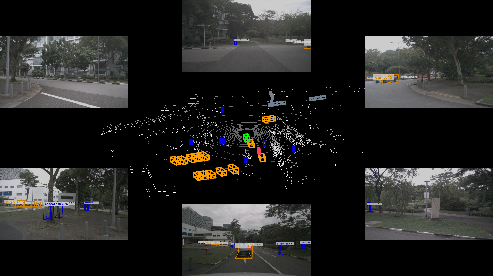
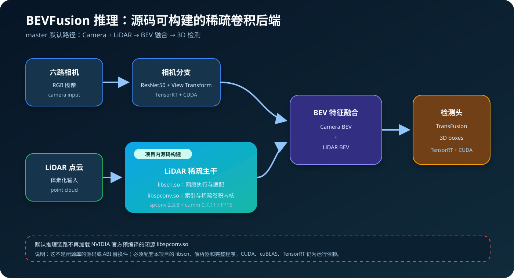
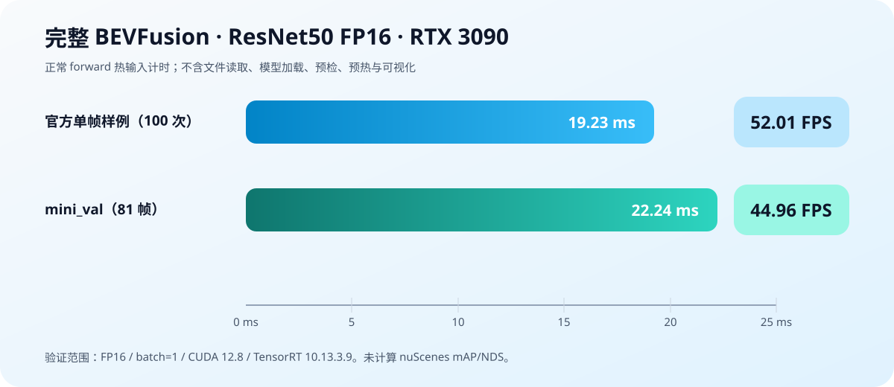
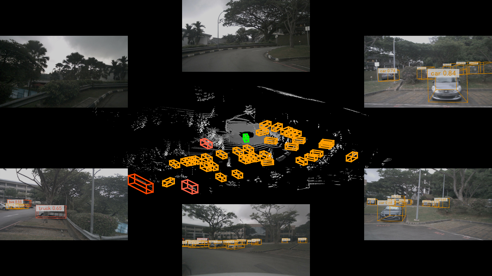

# BEVFusion C++/CUDA 推理：用源码可构建的稀疏卷积后端替代闭源动态库

> 本项目实现了六相机与 LiDAR 点云融合的 BEVFusion 推理。`master` 默认不再加载 NVIDIA 项目附带的预编译闭源 `libspconv.so`，而是从仓库内的 spconv、cumm 与兼容层源码生成自己的 `libspconv.so` 和 `libscn.so`。



上图是本分支实际运行产生的结果：外围为六路相机画面，中间为 LiDAR 鸟瞰图，彩色立方体是融合模型输出的三维检测框。它不是单独的稀疏卷积演示，而是相机、LiDAR、BEV 特征融合和检测头全部参与的完整推理。

## 这是一个什么项目

BEVFusion 的目标是把不同传感器的信息放到统一的鸟瞰图（Bird's-Eye View，BEV）坐标系中：

1. 六路相机图像经过 ResNet50、BEV Pooling 与视角变换，得到相机 BEV 特征。
2. LiDAR 点云先被体素化，再由三维稀疏卷积主干提取空间特征，最后转换为 LiDAR BEV 特征。
3. 两路 BEV 特征融合后进入 TransFusion 检测头，输出车辆、行人等目标的三维检测框。

仓库重点是 **C++/CUDA 推理部署**，不是训练框架。相机、融合和检测头继续使用 TensorRT/CUDA；本次改造集中在 LiDAR 稀疏主干，使它可以由项目内源码构建和调试。

## 原来的问题：稀疏主干绑定预编译库

原部署方式依赖 NVIDIA 项目提供的特定 `libspconv.so`。这个文件只有针对部分 CUDA 与硬件组合的预编译版本，缺少对应实现源码。更换 CUDA、GPU、编译器或系统 ABI 后，常见问题包括：

- 找不到匹配当前环境的动态库；
- 同名库能够被加载，但符号或 ABI 不匹配；
- 无法定位内核行为，也无法针对目标架构重新生成 CUDA 代码；
- 项目的稀疏卷积能力被一个不可审查的二进制文件限制。

本项目没有反编译该文件，也没有得到 NVIDIA 闭源库的源码。采用的方法是实现一条可审查、可重新编译的替代路径。

## 现在的方案：两层源码动态库



新的 LiDAR 稀疏主干由两个动态库配合完成：

| 动态库 | 作用 | 源码来源 |
| --- | --- | --- |
| `libspconv.so` | 生成活跃体素的邻接索引，执行 Mask Implicit GEMM、稀疏卷积等底层 CUDA 计算 | 仓库内固定版本的 spconv 2.3.8 与 cumm 0.7.11 |
| `libscn.so` | 管理稀疏张量和执行图，调度卷积，并实现 Add、ReLU、Add+ReLU、SparseToDense 等操作 | `libraries/New3DSparseConvolution/libspconv` 中的 C++/CUDA 兼容层 |

依赖方向是：

```text
BEVFusion / ONNX parser
        ↓
     libscn.so
        ↓
   libspconv.so
        ↓
 CUDA / cuBLASLt
```

这里需要特别说明：新生成的 `libspconv.so` 与原 NVIDIA 文件同名，但 **API/ABI 不兼容**。它不是把一个 `.so` 复制进旧程序就能完成的替换，必须使用本分支的 `libscn.so`、解析器和完整 BEVFusion 程序。

## 稀疏卷积在这里如何工作

LiDAR 空间中绝大多数体素没有点。普通三维卷积仍会为这些空位置分配特征并计算；稀疏卷积主要保存活跃体素：

```text
coordinates: [N, 4]   # batch、x、y、z
features:    [N, C]   # N 个活跃体素的 C 维特征
```

每个稀疏卷积层先按照 kernel、stride、padding 和 dilation 建立输入行与输出行的索引关系，再根据有效邻居的 mask 和排序结果执行隐式矩阵乘法。计算过程不会展开完整的稠密三维 `im2col`，也不会在每层都转成稠密张量。只有稀疏主干末端才把特征 scatter 到 BEV 稠密平面，交给后续融合网络。

当前推理实现覆盖 BEVFusion 使用的 SparseConvolution/SubMConv、残差 Add、ReLU 及融合后的 ScatterDense 尾部，支持 XYZ/ZYX 坐标顺序。

## 源码与构建入口

与稀疏后端相关的主要目录如下：

```text
libraries/New3DSparseConvolution/
├── third_party/
│   ├── spconv/              # 固定版本的完整源码快照
│   └── cumm/                # 固定版本的完整源码快照
├── libspconv/
│   ├── include/             # 执行层公开接口
│   └── src/                 # libscn.so 的 C++/CUDA 实现
├── build_deps.sh            # 生成并编译底层 libspconv.so
├── prepare_sources.py       # 来源与源码指纹检查
└── CMakeLists.txt           # 编译 libscn.so 和独立检查程序
```

底层源码版本、commit、归档校验和及许可证记录在 [`third_party/source-manifest.json`](../libraries/New3DSparseConvolution/third_party/source-manifest.json)。兼容层来源和本地修改说明见 [`UPSTREAM.md`](../libraries/New3DSparseConvolution/UPSTREAM.md)。构建脚本会检查源码状态，避免修改源码后静默复用旧的生成目录。

简化后的构建顺序为：

```bash
git clone --branch master --single-branch \
  https://github.com/luogantt/Robot_infer.git
cd Robot_infer/bevfusion_agx

export PROJECT_ROOT="$PWD"
export SCN_ROOT="$PROJECT_ROOT/libraries/New3DSparseConvolution"
export NEWSCN_DEPS_ROOT="$SCN_ROOT/_deps-sm86"
export PYTHON=python3
export CUDA_HOME=/usr/local/cuda
export PATH="$CUDA_HOME/bin:$PATH"
export CUDACXX="$CUDA_HOME/bin/nvcc"
export CUMM_CUDA_ARCH_LIST=8.6
export CMAKE_CUDA_ARCHITECTURES=86

bash "$SCN_ROOT/build_deps.sh"
cmake -S "$SCN_ROOT" -B "$SCN_ROOT/build-sm86" \
  -DCMAKE_BUILD_TYPE=Release \
  -DCMAKE_CUDA_COMPILER="$CUDACXX" \
  -DNEWSCN_DEPS_ROOT="$NEWSCN_DEPS_ROOT" \
  -DCMAKE_CUDA_ARCHITECTURES=86 \
  -DPython3_EXECUTABLE="$(command -v "$PYTHON")"
cmake --build "$SCN_ROOT/build-sm86" --parallel 2
```

这会得到底层 `libspconv.so`、执行层 `libscn.so` 和独立验证程序。完整 TensorRT 环境、模型与主程序构建参数较多，请直接使用项目的[完整构建与推理指南](../libraries/New3DSparseConvolution/README.md)。

## 完整推理验证

2026 年 10 月 17 日，我们在一台 RTX 3090 24 GB 机器上，从新的依赖与构建目录重新生成了两个稀疏动态库、完整 BEVFusion 程序以及四个 TensorRT 引擎。实际环境为 Ubuntu 22.04、CUDA 12.8.93、TensorRT 10.13.3.9、GCC 11.4，目标架构为 SM 86。

动态链接检查确认程序加载的是本轮源码生成的 `libscn.so` 和 `libspconv.so`，没有加载旧的 NVIDIA 预编译稀疏库。验证内容包括：

- BEVFusion 稀疏主干 XYZ、ZYX 两种布局的数值参考对照；
- 8/8 个非方形坐标与 ScatterDense 回归用例；
- 官方六相机与 242,180 点样例的完整推理；
- nuScenes mini_val 两个场景，共 81/81 帧完整推理；
- 四个 TensorRT 引擎从 ONNX 重新生成，记录均为 `reused: false`。



| 完整 ResNet50 FP16 推理 | 平均延迟 | P95 | 单帧串行 FPS |
| --- | ---: | ---: | ---: |
| 官方样例，预热 10 次、测量 100 次 | 19.226500 ms | 19.548640 ms | 52.011548 |
| mini_val，首帧预热 10 次、81 帧各测量一次 | 22.242601 ms | 23.898073 ms | 44.958771 |

计时采用正常 `Core::forward` 的同步 CPU 墙钟，覆盖 host 输入复制、预处理、相机和 LiDAR 分支、融合、检测头、解码以及检测框返回；不包含文件读取、模型加载、标定更新、未计时的 raw-head 预检查、预热和可视化。因此这里的 FPS 是单帧热输入推理换算值，不是包含数据加载的应用吞吐率。



两组测试的原始输出均通过有限值检查，点云没有被截断。图片表明完整数据链路可以运行并生成三维检测结果，但图片检查不能替代精度评估；本轮没有计算 nuScenes mAP/NDS，也没有宣称相对于原闭源后端的检测精度或性能提升。完整误差、环境、显存和计时口径记录见 [`VALIDATION.md`](../libraries/New3DSparseConvolution/VALIDATION.md)。

## 仍然依赖什么

“不再依赖 NVIDIA 官方闭源稀疏动态库”不等于“不再依赖 NVIDIA 软件”。当前完整推理仍需要：

- NVIDIA CUDA 驱动与 Toolkit；
- cuBLAS/cuBLASLt；
- TensorRT，用于相机、融合和检测头；
- 与目标机器匹配的 CUDA 架构和 C++ ABI。

目前验证范围是 Linux、CUDA、FP16、batch=1。RTX 3070 Ti 和 RTX 3090 都是 SM 86，可以使用同一架构目标，但性能数字只来自物理 RTX 3090。INT8、瑞芯微 NPU、华为昇腾、其他 CUDA 架构和跨系统二进制兼容性尚未完成验证。

## 项目的意义

这次改造解决的关键问题不是“多了一个同名 `.so`”，而是把 LiDAR 稀疏主干的控制权重新放回源码：

- 可以看见实际执行的稀疏索引生成和 CUDA 卷积代码；
- 可以针对目标 GPU 架构重新编译，而不是寻找碰巧匹配的预编译库；
- 可以修改、验证并记录源码版本与构建来源；
- 完整 BEVFusion 推理不再被一个闭源稀疏二进制文件卡住。

`master` 现在维护这条源码后端；原 Jetson AGX 版本完整保留在 [`orin-AgX`](https://github.com/luogantt/Robot_infer/tree/orin-AgX) 分支。

## 延伸阅读

- [项目首页与快速入口](../README.md)
- [从源码编译动态库、主程序和运行推理](../libraries/New3DSparseConvolution/README.md)
- [分批 GPU 验证记录](../libraries/New3DSparseConvolution/VALIDATION.md)
- [源码来源、许可证与本地修改](../libraries/New3DSparseConvolution/UPSTREAM.md)
